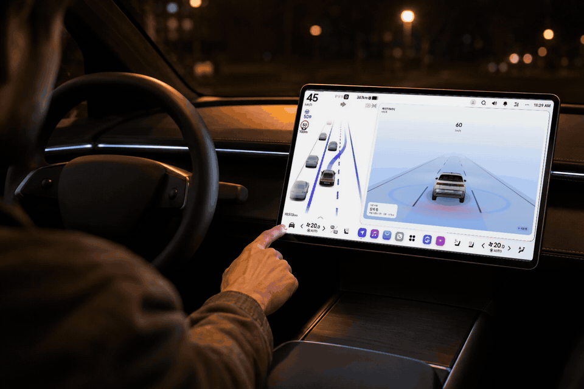
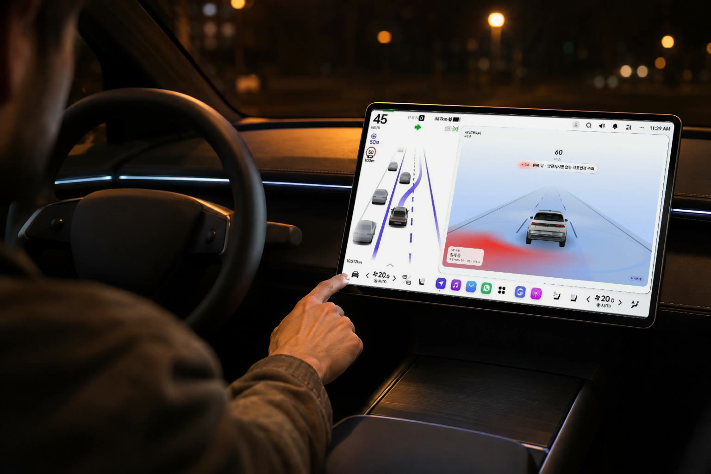
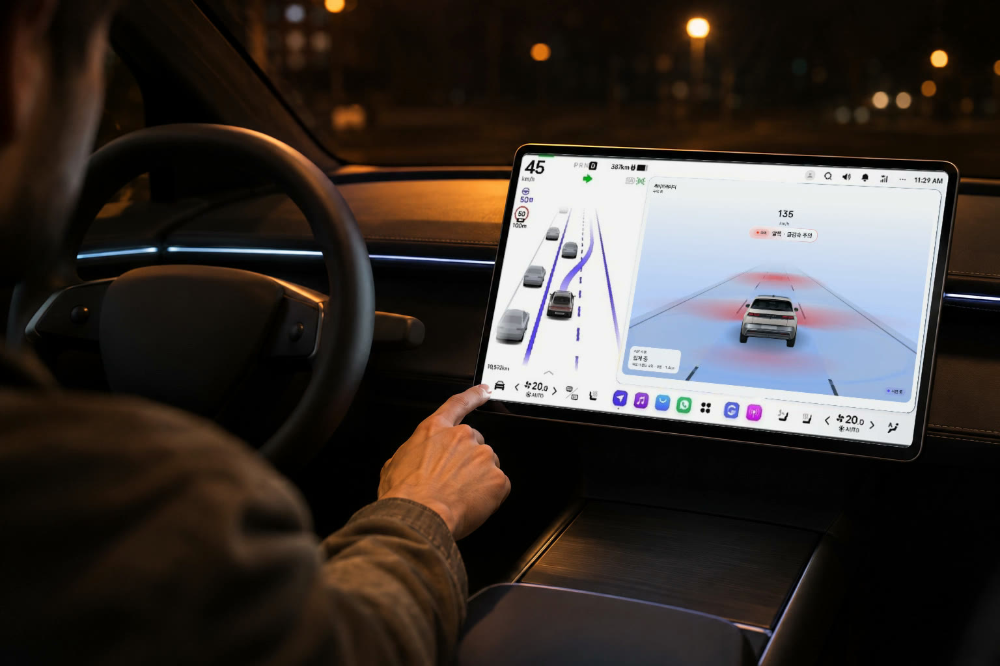
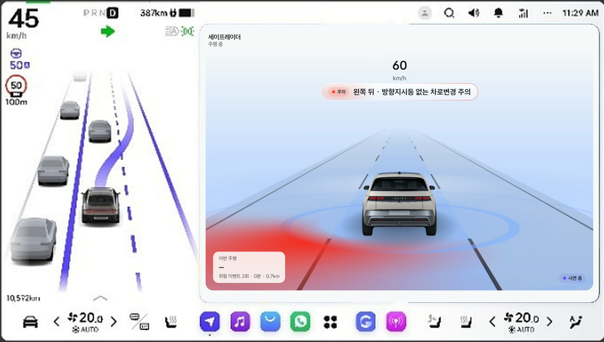
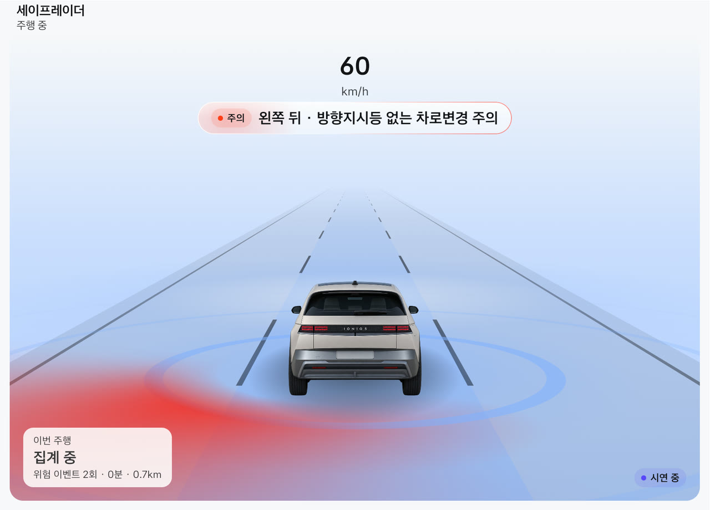
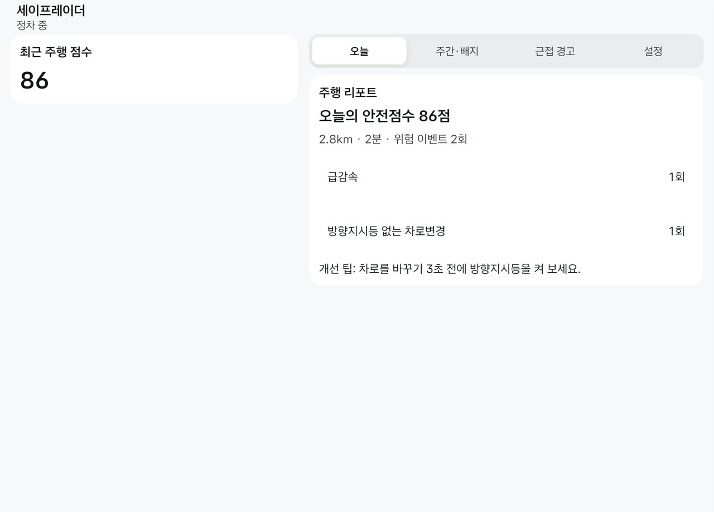
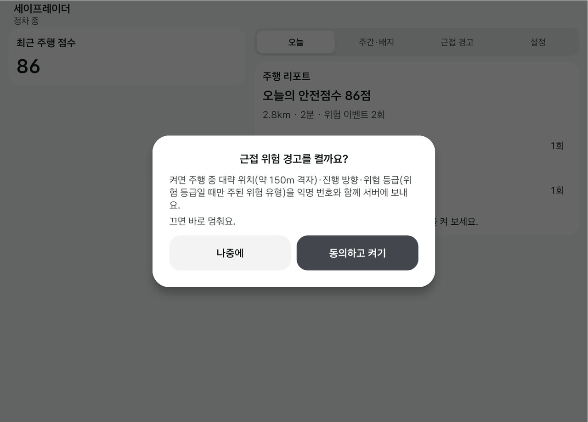

# 세이프레이더 SafeRadar

옆 차가 위험하게 달려도 미리 알 방법이 없습니다. 이 앱은 내 운전을 점수로 보여 주고, 동의한 운전자끼리 가까이 있는 위험 차량을 서로 알려 줍니다. 점수(0~100)는 차량 신호로 이 기기에서 계산하고, 근접 경고는 옵트인 동의한 운전자끼리 임의 번호로 주고받습니다. 위험 등급 차량이 가까이 있으면 음성(TTS)과 상단 3초 배너로 알립니다. (`com.hmgcarapp.saferadar`)



왼쪽 뒤 급차선변경 차량, 앞쪽 급제동 차량 경고 순간입니다. 차량 실내 이미지와 Pleos Connect 화면 스크린샷 위에, 에뮬레이터에서 실제로 실행한 세이프레이더 주행 화면(시연 모드)을 합성했습니다. 왼쪽 주행 화면·상태바·하단 독은 Pleos 스크린샷이고, 오른쪽 2분할 앱 창(1700×1184dp)이 실제 앱 화면입니다. 전체 영상: [saferadar-in-car.mp4](docs/media/saferadar-in-car.mp4)

| 왼쪽 뒤 위험 | 앞쪽 위험 | 2분할 화면 확대 |
|---|---|---|
|  |  |  |

## 주요 기능

| 주행 중 근접 경고 | 정차 후 주행 리포트 | 근접 경고 동의 |
|---|---|---|
|  |  |  |

Pleos Connect v2.1.0 에뮬레이터에서 앱을 실행해 찍은 앱 창 화면입니다.

- 위험 이벤트 5종 감지: 급감속 · 급가속 · 방향지시등 없는 차로변경 · 고속 지속 · 급격한 고속 진입
- 주행 점수 리포트: 주차 시 오늘의 점수·감점 구간·개선 팁, 주간 추이, 배지. 기록은 최근 60회, 이 기기에만 저장
- 근접 경고(옵트인, 기본 꺼짐): 같은 방향 약 200m 안의 위험 등급 차량을 음성과 배너로 안내
- 주행 중에는 읽기 전용 한 화면: 하늘색 도로 위 내 차(아이오닉 5)와 내 차에서 퍼지는 감지 파장, 위험 차량이 있는 방향으로 빨간 빛이 번짐. 경고 문구는 반투명 유리 배너. 시스템 애니메이션을 끄면 정지 화면으로 표시. 설정은 정차 중에만 변경

## 실행 방법
1. 에뮬레이터에 `apk/hmg-car-app-team_SafeRadar_release.apk` 를 설치해 실행합니다 (`adb install`).
2. 근접 경고는 서버 없이 시연 모드로 확인합니다. 정차 상태에서 **설정 탭 > 시연 시작**을 누르면 약 2분 12초 동안 가상 주행이 재생되고, 주행 화면으로 바뀐 뒤 36초쯤 왼쪽 뒤 급차선변경 차량, 58초쯤 앞쪽 급제동 차량 경고(음성·배너·위험 방향 빛)가 나옵니다. 끝나면 정차 화면에 그 주행의 리포트가 뜹니다. 시연 데이터는 저장하지도, 서버로 보내지도 않습니다.
3. 실제 차량 신호로 보려면 Pleos Connect Virtual Console(`adb forward tcp:8088 tcp:8088` 뒤 http://127.0.0.1:8088)에서 기어를 D, 속도를 20km/h 이상으로 바꿉니다. 방향지시등을 끈 채 60km/h 이상에서 조향각을 좌우로 빠르게 흔들면 "방향지시등 없는 차로변경"이 감지됩니다. 서버와 주고받는 근접 경고(로컬 테스트 서버)는 이 저장소에 포함하지 않았습니다.

## 테스트 환경
- Pleos Connect v2.1.0 에뮬레이터 (AVD 이름 pleos21), Android 14 (API 34)
- 화면 2560x1440, 가로(Landscape)

## APK 위치
`apk/hmg-car-app-team_SafeRadar_release.apk` (버전 0.2.0, 최소 SDK 28 / target 35). Pleos Connect v2.1.0 에뮬레이터에 설치하고 주행 신호를 주입해 확인했습니다.

## 개인정보
- 기기에 저장: 최근 60회 주행 기록(시각·점수·거리·시간·이벤트 횟수)만 앱 전용 저장소에 둡니다. 이동 경로·음성은 저장하지 않습니다. `설정 > 기록 > 저장된 주행 기록 모두 삭제`로 지웁니다.
- 서버 전송은 옵트인(기본 꺼짐)입니다. 동의 후 주행 중 20km/h 이상일 때만 10분마다 바뀌는 임의 번호·Geohash7(약 150m 격자)·8방위·위험 등급(위험 등급일 때만 주된 유형 코드)을 보냅니다. 임의 번호는 익명성을 보장하지 않습니다. 이름·계정·기기 번호·차량번호·정확한 좌표·속도·주행 점수/기록·음성은 보내지 않습니다.
- 이동 경로를 저장하지는 않지만 같은 번호로 최대 10분간 연속된 대략 위치(약 150m 격자)를 보내고, 서버는 접속 IP 를 볼 수 있어요.
- 이 앱이 설계상 연결하는 서버(로컬 테스트 서버 기준)는 위치를 메모리에만 두고 디스크·로그에 남기지 않아요. 약 15초 뒤 만료되고 다음 요청 때 정리돼요.
- 동의 철회: 근접 경고 탭의 스위치를 끄면 즉시 전송 중단 + 임의 번호 폐기 + 서버에 내 항목 삭제 요청(`/v1/leave`)을 보냅니다.
- 서버는 로컬 테스트용(`127.0.0.1`)이며 운영·배포하지 않았습니다.

## 권한과 데이터 출처
- 권한: 차속·기어·브레이크 페달·조향각·방향지시등(Pleos Vehicle SDK), 위치(FusedLocation), 음성 안내(TTS), 포그라운드 서비스·알림, 인터넷(동의 후 서버 연동에만 사용)
- 외부 점수 데이터·API 는 쓰지 않으며 점수는 이 기기에서 계산합니다. API 키 등 비밀값은 저장소에 없습니다.

## 소스 빌드·테스트
`app/` 폴더만으로 단독 빌드됩니다(JDK 17, Android SDK 필요, Pleos SDK 는 공개 Maven 에서 받으므로 인터넷 필요).

```bash
cd app
./gradlew :safe-radar:assembleDebug :safe-radar:assembleRelease
./gradlew :core:test :safe-radar:testDebugUnitTest
```

release 서명 키는 저장소에 없습니다. `app/.signing/signing.properties`(`storeFile`, `storePassword`, `keyAlias`, `keyPassword`)와 키 파일을 두면 그 키로 서명하고, 없으면 서명되지 않은 release APK 가 나옵니다(`.signing/` 은 .gitignore).

서드파티 고지는 `app/NOTICE`, 폰트 라이선스는 `app/licenses/` 에 있습니다.
