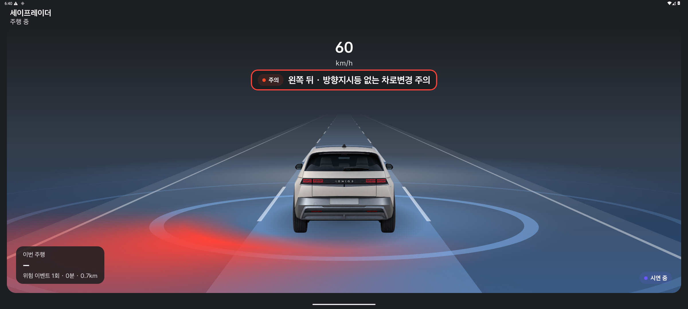
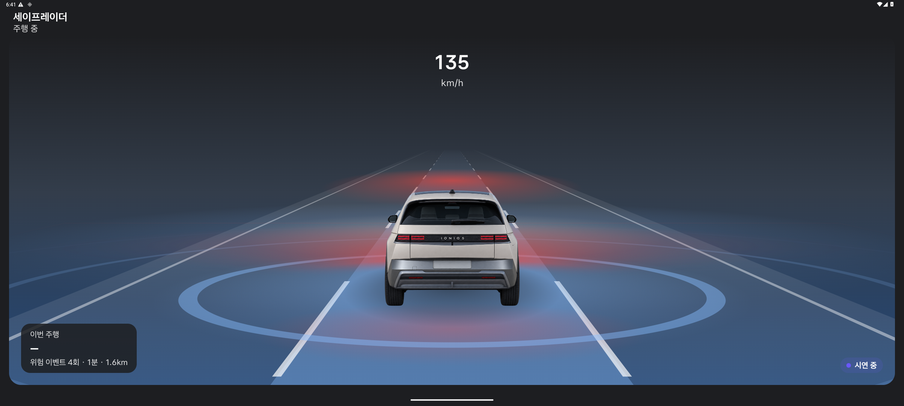
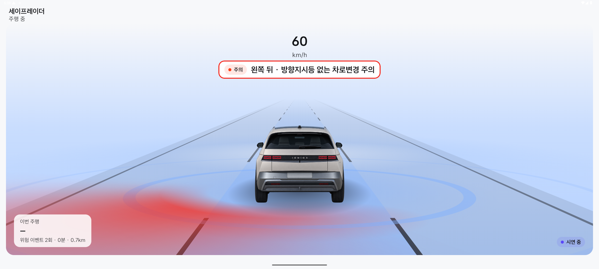
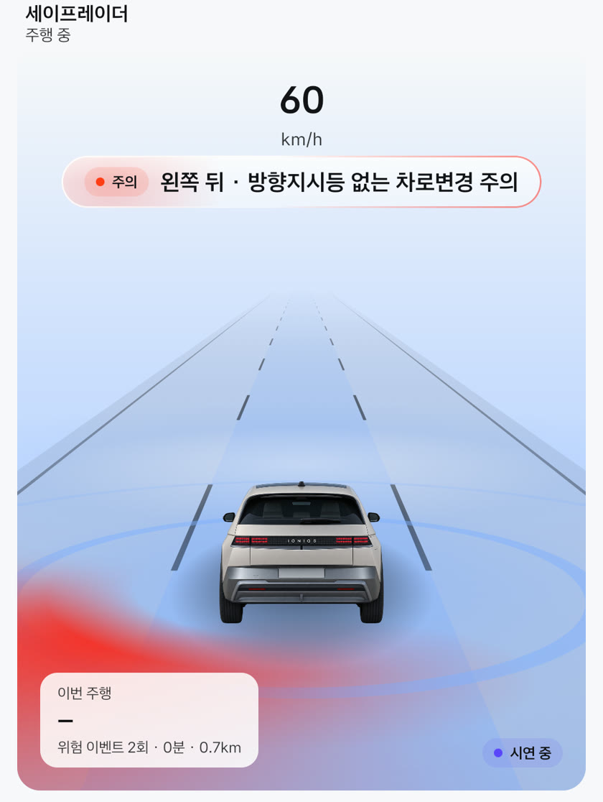
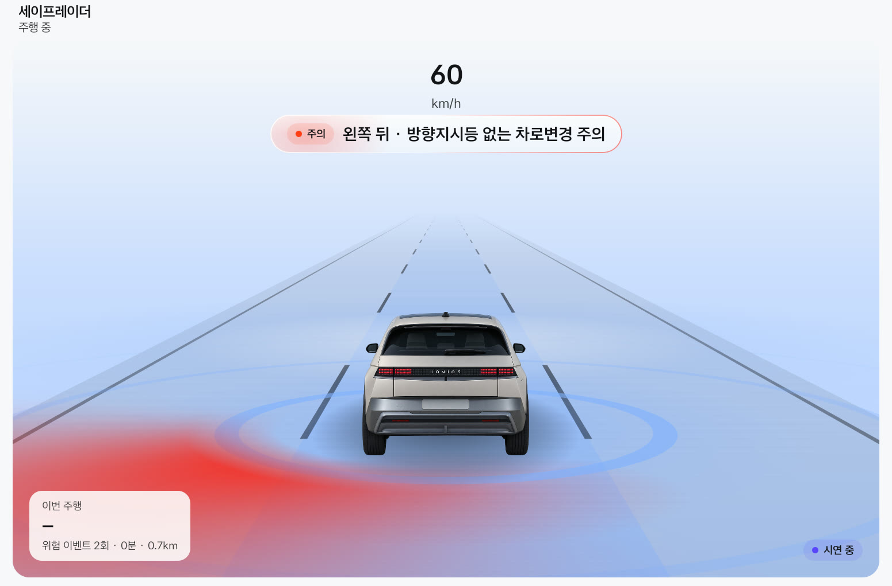
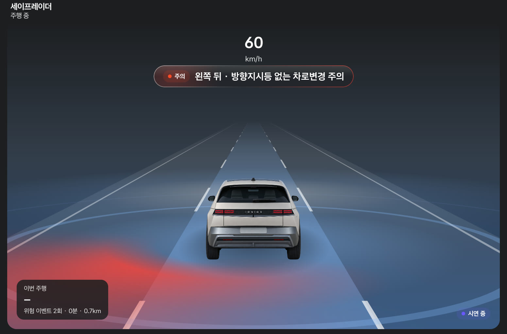
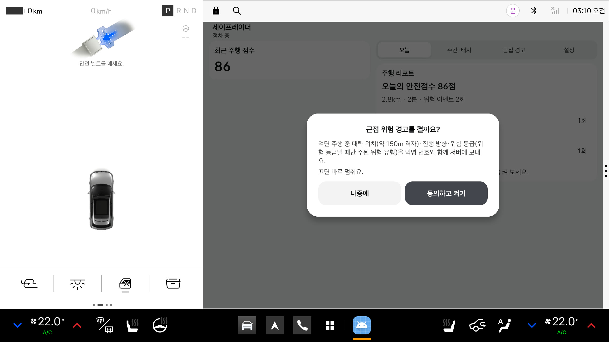
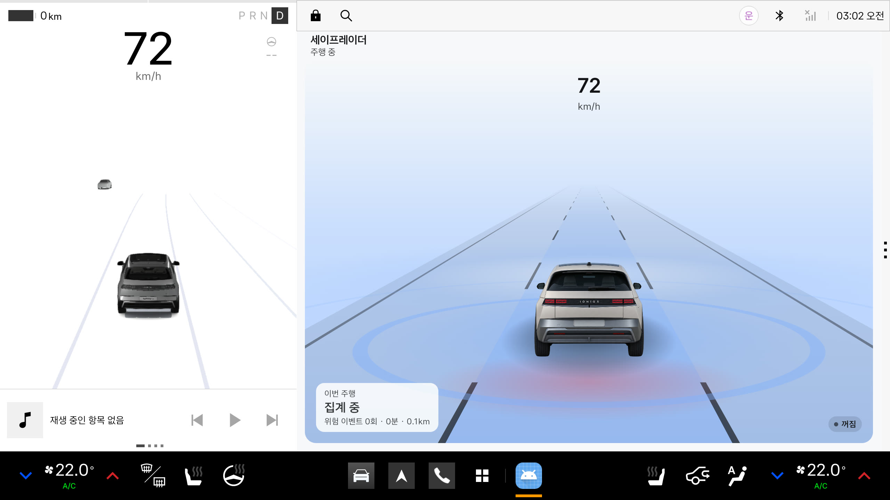
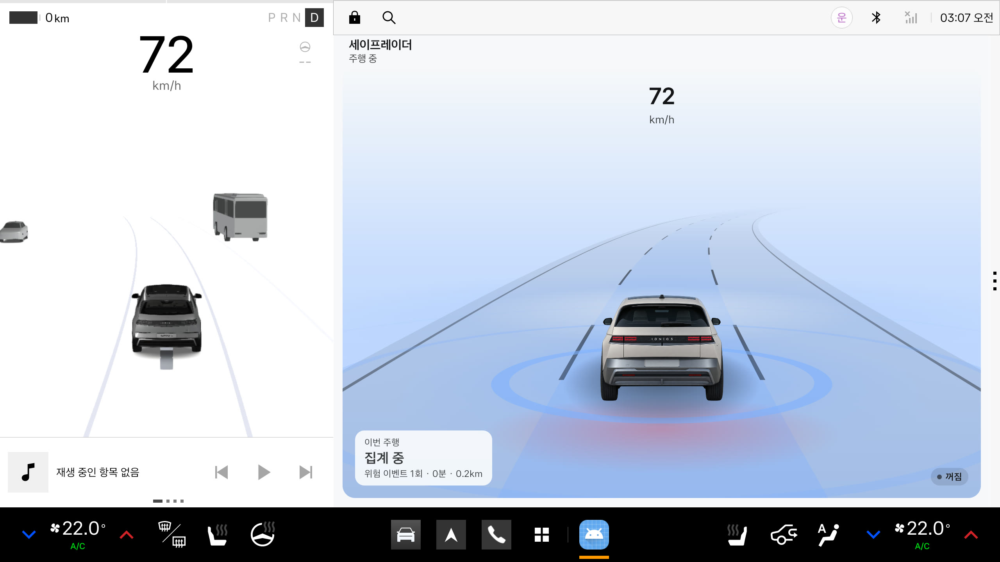

# 주행 화면 개편: 하늘색 도로 뷰

브랜치 `feat/tesla-sky-radar-ui`. 주행 중 화면(`DrivingView`)을 텍스트 카드 두 장에서, 도로 위 내 차(아이오닉 5)와 주변 위험 방향을 한눈에 보여 주는 장면으로 바꾼다.

## 왜 바꾸나

기존 주행 화면은 점수 숫자와 3초 문장 배너뿐이라, 운전자가 위험 차량이 어느 쪽에 있는지 알려면 글을 읽어야 했다. 주행 중에는 0.5초 안에 방향을 알아야 하므로 방향을 위치와 색으로 보여 준다.

## 레퍼런스 분석(테슬라 주행 화면)

| 레퍼런스 요소 | 하는 일 | 세이프레이더 적용 |
|---|---|---|
| 위쪽 중앙 큰 속도 | 가장 자주 보는 값 | 실제 차속, 값이 없으면 "–" |
| 왼쪽 제한속도 표지 | 규정 대비 확인 | NaviHelper 제한속도가 최근 10초 안에 있을 때만 국내 표지 모양으로 표시 |
| 소실점으로 모이는 휘는 차선 | 공간감, 진행 방향 | 3차로 원근 도로. 조향각에 따라 휘고, 내 차로 경계 점선이 실제 속도로 흐름 |
| 뒤에서 본 사실적인 내 차, 차 너머의 빛 | 기준점, 고급감 | 아이오닉 5 렌더 이미지(픽셀 리어램프), 차 앞쪽 바닥으로 번지는 빛, 후미등 반사 |
| 차 둘레 감지 표시, 위험 쪽만 빨강 | 어느 방향이 위험한지 | 내 차에서 위험 방향으로 번지는 빨간 그라디언트(각도·거리 모두 부드럽게 감쇠) |

여기에 요청한 하늘색 그라디언트 하늘과, 내 차에서 바닥을 따라 퍼지는 하늘색 파장(감지가 켜져 있음)을 더했다.

## 핵심 설계: 바닥 평면 하나로 투영

1차 시안은 차선·파장·감지 원호를 화면 좌표에서 각각 다른 중심과 납작함으로 그려 서로 각도가 맞지 않았다. 지금은 바닥 위에 있는 모든 것(도로, 차로 카펫, 파장, 위험 그라디언트, 그림자, 바닥광)을 미터 단위 바닥 좌표(x 오른쪽, z 앞)에서 그리고, 핀홀 카메라 원근 행렬 하나(`GroundCamera.matrix`)로 화면에 옮긴다. 그래서 같은 소실점·같은 기울기로 맞물린다. 차 이미지는 같은 카메라로 계산한 폭과 접지선에 맞춰 놓는다.

- 카메라: 화면 비율로 정함(지평선 30%, 뒤 범퍼 80%, 차 폭 = 화면 높이 40% 이내). 차 뒤 12m.
- 위험 그라디언트: 각도 방향은 부채꼴 그라디언트(중심 1 → ±70°에서 0, 끝 기울기 0이라 경계선 없음), 거리 방향은 원형 마스크를 곱한다. 방향이 바뀌면 짧은 쪽으로 0.45초 동안 돌고, 경고가 끝나면 0.4초 동안 꺼진다.
- 앞쪽 경고: 뒤에서 본 차체가 바로 앞 바닥(약 30m)을 가린다. 반경만 늘리면 먼 거리에서 부채꼴이 화면 전체 폭의 띠가 되므로, 차 둘레 빛은 모든 방향 11m로 두고 앞쪽 계열 경고에만 차 지붕 너머 40m 지점에 앞뒤로 긴 보조 빛을 더한다(왼쪽·오른쪽 앞이면 6m 비킴). 보조 빛이 차에 가려지지 않는지 테스트로 고정했다.

## 지키는 제약

1. 데이터 정밀도: 서버는 주변 차량을 Geohash7 셀(약 150m)과 8방향으로만 준다. 다른 차의 모델이나 차로 위 위치는 그리지 않고 방향만 빛으로 보여 준다. 정확해 보이는 거짓 위치를 만들지 않기 위해서다.
2. 주행 중 조작 없음: 화면은 읽기 전용이다. 음성·배너 반복 억제(8초·30초) 규칙은 그대로다.
3. 방향 표시는 경고와 분리: `WarnState.radar` 가 가장 최근 응답에서 가장 가까운 위험 차량 방향을 5초(응답 주기 3초보다 길게) 유지한다. 배너가 사라져도 차량이 범위 안에 있는 동안 빛은 켜져 있다.
4. 디자인시스템 규칙(`SourceRulesTest`): ui 패키지에서 하드코딩 색·dp·sp 금지. 색은 Pleos 토큰에서만 만든다(하늘색 = regulation_blue 와 흰색 혼합).
5. 움직임 예산: 파장 3초 주기, 위험 빛 맥동 0.9초, 차선 점선 이동(정차 시 정지). 모두 그리기 단계에서만 다시 그린다. 시스템 애니메이션 배율이 0(접근성 '애니메이션 삭제' 포함)이면 모두 멈추고 파장은 고정 동심원, 위험 빛은 최대 밝기로 바로 켜고 끈다.
6. 차 이미지: 이미지 생성으로 만든 아이오닉 5 뒷모습(투명 배경, 720×618 PNG, `res/drawable-nodpi/ego_car.png`). 번호판은 비워 두었다.

## 구현

| 파일 | 변경 |
|---|---|
| `ui/RoadScene.kt` | 하늘, 바닥 투영(`GroundCamera`), 도로·파장·위험 그라디언트, 차 이미지 배치. 순수 계산은 `RoadMotion` |
| `res/drawable-nodpi/ego_car.png` | 아이오닉 5 렌더 |
| `ui/Screens.kt` | `DrivingView` = 장면 + 속도/제한속도/경고 배너/주행 요약 칩/공유 상태 배지. 경고 배너는 반투명 유리(리퀴드 글래스) 알약 모양: 반쯤 비치는 바탕, 윗면 광택, 왼쪽 위 흰빛에서 오른쪽 아래 붉은빛으로 이어지는 테두리 |
| `domain/WarnFlow.kt` | `Banner.direction`, `RadarMark`, `WarnState.radar` |
| `app/UiState.kt`, `app/RadarController.kt` | 틱마다 `DriveMotion`(속도·제한속도·조향각, 최근 값만) 갱신 |

## 검증

- 단위 테스트: `RoadMotionTest`(왼쪽 경고가 왼쪽을 가리키는지, 그라디언트가 매끄럽게 감쇠하는지, 투영 행렬과 차 배치가 같은 카메라 식을 따르는지, 앞쪽 빛이 차 너머로 보이는지, 바닥 그림이 카메라 앞에만 있는지), `WarnFlowTest`(방향 유지·해제). 전체 통과.
- 에뮬레이터: 2400×1080 가로, 160dpi 에서 시연 모드(`am broadcast -a com.hmgcarapp.saferadar.SIM -p com.hmgcarapp.saferadar --ez demo true`)로 라이트·다크 테마 확인.

| 다크 · 왼쪽 뒤 위험 | 다크 · 앞쪽 위험 | 라이트 · 왼쪽 뒤 위험 |
|---|---|---|
|  |  |  |

## 분할 화면

Pleos Connect-S(2560×1440)에서 앱 창은 왼쪽 주행 화면(840) 옆에 붙는다. 3분할이면 세로 840×1184dp 창, 2분할이면 가로 1700×1184dp 창이다. 에뮬레이터 화면을 이 창 크기로 맞춰(3분할: 1050×1480px·200dpi, 2분할: 1551×1080px·146dpi) 시연 모드의 경고 순간을 캡처했다. 에뮬레이터 상태바·내비게이션 바는 잘라냈다.

- 세로 창에서는 차 폭을 창 폭의 30%로 키운다(가로 창은 폭 20%·높이 40% 중 작은 값). 차 윗변이 속도 표시를 침범하지 않고 앞쪽 보조 빛이 차에 가려지지 않는지 세 창 크기 모두 테스트로 확인한다.
- 경고 배너는 3분할 세로 창에서도 한 줄로 들어간다.

| 3분할 · 라이트 (840×1184dp) | 2분할 · 라이트 (1700×1184dp) | 2분할 · 다크 |
|---|---|---|
|  |  |  |

## 차량 합성 영상(README)

`docs/media/saferadar-in-car.*` 는 실제 앱 화면을 차량 사진에 합성한 것이다. 시스템 영역은 사진을 쓰고, 세이프레이더 부분만 실제 렌더링이다.

1. 에뮬레이터(GPU 렌더링)를 2분할 앱 창 크기(1551×1080px, 146dpi = 1700×1184dp)·라이트 테마로 맞추고, 시연 모드 시작 후 30초부터 42초간 `screenrecord`(약 27fps).
2. Pleos Connect 3분할 스크린샷의 가운데·오른쪽 앱 칸(2분할 창 자리)에 녹화 영상을 둥근 모서리로 덮는다.
3. 그 화면을 차량 실내 이미지의 디스플레이 네 모서리에 맞춰 원근 변환하고(ffmpeg `perspective`), 디스플레이 영역 마스크로 잘라 사진 위에 얹는다.
4. GIF 는 두 경고 구간(왼쪽 뒤, 앞쪽)만 이어 960px·10fps 로 만든다.

차량 실내 이미지는 이미지 생성으로 만든 원본(로고·문구·워터마크 없음, 화면이 켜진 빈 디스플레이)이다. 디스플레이 영역 마스크는 네 모서리 사각형과 밝은 무채색 픽셀의 곱으로 만들어, 화면을 누르는 손가락은 합성 화면 앞에 그대로 남는다.

## Pleos Connect 에뮬레이터 검증 (pleos21)

공식 Nexus 의 Pleos Connect v2.1.0 시스템 이미지(arm64, SHA-1 일치 확인)로 AVD `pleos21`(2560×1440, 160dpi, Cold boot)을 만들고, release APK 를 설치한 뒤 Virtual Console(`adb forward tcp:8088 tcp:8088`)로 차량 신호를 주입했다. Virtual Console 은 브라우저가 1초마다 `POST /browser/session` 을 보내야 쓰기 요청을 받는다(없으면 503 `emulator_inactive`).

| 확인 항목 | 결과 |
|---|---|
| 기어 P → D, 속도 72km/h | 정차 화면이 주행 화면으로 바뀌고 속도 72 가 시스템 표시와 같이 나온다 |
| 조향각 부호 | Pleos 조향각은 **왼쪽이 +** 다(+90° 에서 시스템 주행 화면 도로가 왼쪽으로 휜다). 처음 가정(오른쪽 +)과 반대여서 `RoadMotion.curveFor` 부호를 뒤집고 테스트로 고정했다. 수정 뒤 두 화면이 같은 쪽으로 휜다 |
| 방향지시등 | 꺼진 상태에서 72km/h 로 조향을 ±8° 흔들면 `LANE_CHANGE` 가 감지되고, `BlinkLeft` 를 켠 상태에서는 감지되지 않는다 |
| 애니메이션 끄기 | `animator_duration_scale=0` 이면 0.8초 간격 두 캡처가 바이트 단위로 같다(완전히 정지). 배율 1 에서는 파장이 움직여 달라진다 |
| 제한속도 | Virtual Console 에 제한속도 항목이 없어 확인하지 못했다(NaviHelper 경로 안내 중에만 들어온다) |
| 차속 경로 | Pleos 이미지에는 android.car CarPropertyManager 가 없어 그 경로는 실패하고 Pleos Vehicle SDK 경로로 속도를 받는다(로그 경고 1줄, 동작 영향 없음) |

| 정차 | 주행 72km/h | 조향 왼쪽(+90°) |
|---|---|---|
|  |  |  |

## 남은 일

1. 실차에서 제한속도 표지(NaviHelper) 확인.
2. 속도 숫자는 디자인시스템 최대 글자(headlineLarge)를 쓴다. 더 키우려면 계기판용 글자 단계를 디자인시스템에 추가해야 한다.
