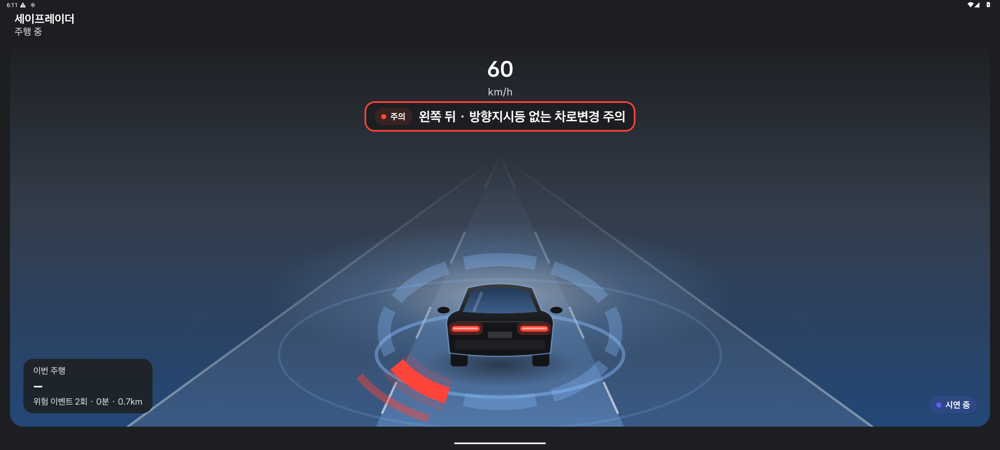
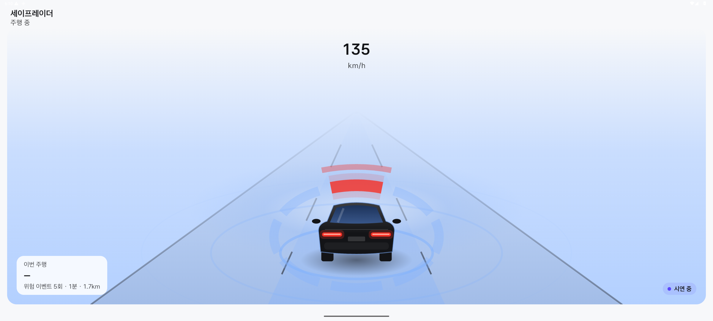
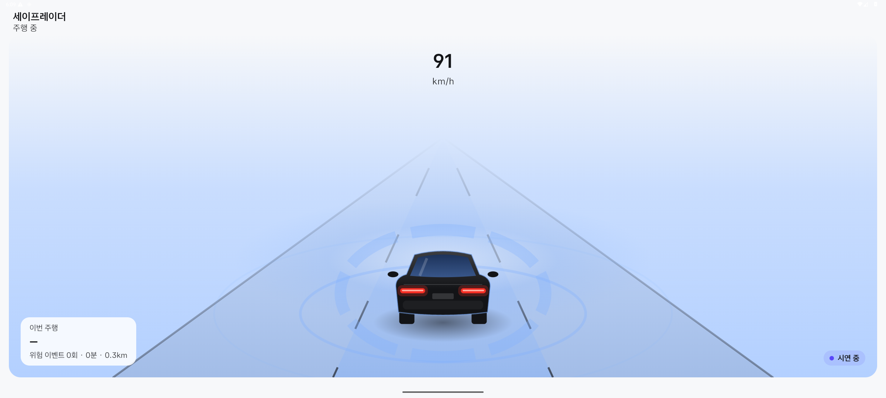

# 주행 화면 개편: 하늘색 도로 뷰

브랜치 `feat/tesla-sky-radar-ui`. 주행 중 화면(`DrivingView`)을 텍스트 카드 두 장에서, 도로 위 내 차와 주변 위험 방향을 한눈에 보여 주는 장면으로 바꾼다.

## 왜 바꾸나

기존 주행 화면은 점수 숫자와 3초 문장 배너뿐이라, 운전자가 위험 차량이 어느 쪽에 있는지 읽으려면 글을 읽어야 했다. 주행 중에는 0.5초 안에 방향을 알아야 하므로 방향을 위치로 보여 준다.

## 레퍼런스 분석(테슬라 주행 화면)

| 레퍼런스 요소 | 하는 일 | 세이프레이더 적용 |
|---|---|---|
| 위쪽 중앙 큰 속도 | 가장 자주 보는 값 | 실제 차속(`DriveMotion.speedKmh`), 없으면 "–" |
| 왼쪽 제한속도 표지 | 규정 대비 확인 | NaviHelper 제한속도가 최근 10초 안에 있을 때만 국내 표지 모양으로 표시 |
| 소실점으로 모이는 휘는 차선 | 공간감, 진행 방향 | 원근 차선 4줄. 조향각에 따라 소실점이 좌우로 이동, 내 차로 경계 점선은 실제 속도로 흐름 |
| 뒤에서 본 내 차와 뒤쪽 빛 | 기준점 | Canvas 로 그린 내 차(정적 다크 토큰 + 하늘색 림 라이트), 차 너머로 번지는 빛 |
| 차 둘레 감지 원호, 위험 쪽만 빨강 | 어느 방향이 위험한지 | 8방향 원호. 위험 등급 차량이 있는 방향만 빨갛게 맥동(바로 근처면 전체) |

여기에 요청한 하늘색 그라디언트 배경과, 내 차에서 바닥을 따라 퍼지는 하늘색 파장(감지가 켜져 있음)을 더했다.

## 지키는 제약

1. 데이터 정밀도: 서버는 주변 차량을 Geohash7 셀(약 150m)과 8방향으로만 준다. 그래서 다른 차의 3D 모델이나 차로 위 위치는 그리지 않고 방향 원호만 켠다. 정확해 보이는 거짓 위치를 만들지 않기 위해서다.
2. 주행 중 조작 없음: 화면은 읽기 전용이며 버튼이 없다. 경고 음성·배너의 반복 억제(8초·30초) 규칙은 그대로다.
3. 원호는 경고와 분리: 음성은 반복을 막아야 하지만 원호는 차량이 범위 안에 있는 동안 켜져 있어야 한다. `WarnState.radar` 가 가장 최근 응답에서 가장 가까운 위험 차량 방향을 5초(응답 주기 3초보다 길게) 유지한다.
4. 디자인시스템 규칙(`SourceRulesTest`): ui 패키지에서 하드코딩 색·dp·sp 금지. 색은 Pleos 토큰에서만 만든다(하늘색 = `regulation_blue` 와 흰색 혼합). 크기는 캔버스 비율과 `PleosSpacing` 으로만 정해 Connect-S/L/W 에서 같은 구도가 된다.
5. 움직임 예산: 파장 2.6초 주기 1개, 위험 원호 맥동 0.65초, 차선 점선 이동(정차 시 정지)만 쓴다. 모두 그리기 단계에서만 다시 그려 재구성을 일으키지 않는다.

## 구현

| 파일 | 변경 |
|---|---|
| `ui/RoadScene.kt` (신규) | 하늘·도로·빛·파장·원호·내 차를 그리는 Canvas. 방향→각도, 조향→휨 계산은 순수 객체 `RoadMotion` |
| `ui/Screens.kt` | `DrivingView` 를 장면 + 속도/제한속도/경고 배너/주행 요약 칩/공유 상태 배지로 재구성 |
| `domain/WarnFlow.kt` | `Banner.direction`, `RadarMark`, `WarnState.radar` 추가 |
| `app/UiState.kt`, `app/RadarController.kt` | 틱마다 `DriveMotion`(속도·제한속도·조향각, 신선한 값만) 갱신 |

## 검증

- 단위 테스트: `WarnFlowTest`(원호 방향·유지·해제), `RoadMotionTest`(왼쪽 경고가 화면 왼쪽 원호를 켜는지, 조향 휨 상한). 전체 `:core`·`:designsystem`·`:safe-radar` 통과.
- 에뮬레이터: 2400×1080 가로, 160dpi 에서 시연 모드(`am broadcast -a com.hmgcarapp.saferadar.SIM -p com.hmgcarapp.saferadar --ez demo true`)로 정속·왼쪽 뒤 경고·앞쪽 경고를 라이트·다크 테마에서 확인. 배너가 3초 뒤 사라져도 차량이 범위 안에 있는 동안 원호는 유지된다.

| 다크 · 왼쪽 뒤 경고 순간 | 라이트 · 앞쪽 급제동 차량 | 라이트 · 정속 주행 |
|---|---|---|
|  |  |  |

## 남은 일

1. pleos21(2560×1440) 에뮬레이터와 실차에서 조향각 부호(오른쪽 +)와 제한속도 표시 확인.
2. 접근성 설정의 애니메이션 끄기를 따르도록 파장·맥동 정지 옵션 검토.
3. 속도 숫자는 디자인시스템 최대 글자(headlineLarge)를 쓴다. 더 키우려면 디자인시스템에 계기판용 글자 단계를 추가해야 한다.
